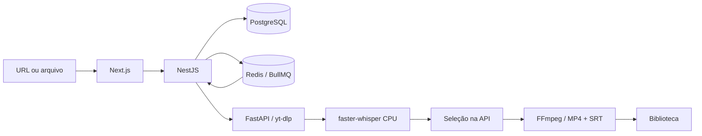

# Arquitetura

| Serviço    | Código               | Responsabilidade                                                                       |
| ---------- | -------------------- | -------------------------------------------------------------------------------------- |
| Web        | `apps/web`           | Next.js, autenticação básica, criação, progresso, Biblioteca e proxy para a API        |
| API        | `apps/api`           | NestJS, contratos Zod, autorização da mídia, conectores, produções e seleção editorial |
| Redis      | Compose              | BullMQ, cache/quotas de descoberta e estado OAuth temporário                           |
| PostgreSQL | `packages/database`  | Prisma: autorizações, mídia, tarefas, consumo LLM, automações, contas e publicações    |
| Worker     | `apps/worker-python` | FastAPI: download, upload, Whisper, FFmpeg e artefatos                                 |

O host publica somente `127.0.0.1:3100` e `127.0.0.1:3101`. Banco, Redis e worker ficam na rede Compose. O worker usa um processo, CPU/INT8, duas threads por padrão e trava de processamento; BullMQ tem concorrência global 1.

`MediaAsset.identity` identifica a origem canônica; `sha256` identifica conteúdo. `Source` preserva licenças verificadas e pode registrar a solicitação autenticada com política interna `PROCESSING`, sem declarar direitos comerciais. Não existe confirmação manual na criação. `Task` registra operação, payload, resultado, estado, erro, parentesco, chave de idempotência e continuação. A chave considera a identidade e as opções normalizadas; transação serializável e unicidade protegem envios concorrentes.

Cada etapa persiste seu resultado e agenda a próxima. Continuações têm recuperação própria e na inicialização. Produções saudáveis não exigem **Retomar**. Seleções interrompidas não repetem chamadas externas indiscriminadamente.

Arquivos ficam em `media/`, montado no worker; modelos no volume `models`. PostgreSQL e Redis conservam seus volumes. Exclusão de Biblioteca é lógica; etapas compartilhadas sobrevivem. Não houve mudança de schema nesta refatoração.

Não foi criado timer de consulta ao PostgreSQL. Consultas ocorrem sob demanda e na recuperação inicial. Automações habilitadas consultam o banco em sua execução; pause-as para favorecer Scale to Zero do Neon. Evite polling externo de `/ready`; healthchecks usam `/health`.

API e worker exigem tokens próprios. O proxy mantém tokens no servidor e verifica origem de mutações. Downloads validam HTTPS, DNS/IP público, certificado, tamanho e mídia real. Veja [YouTube](youtube.md) e [conectores](connectors.md).
